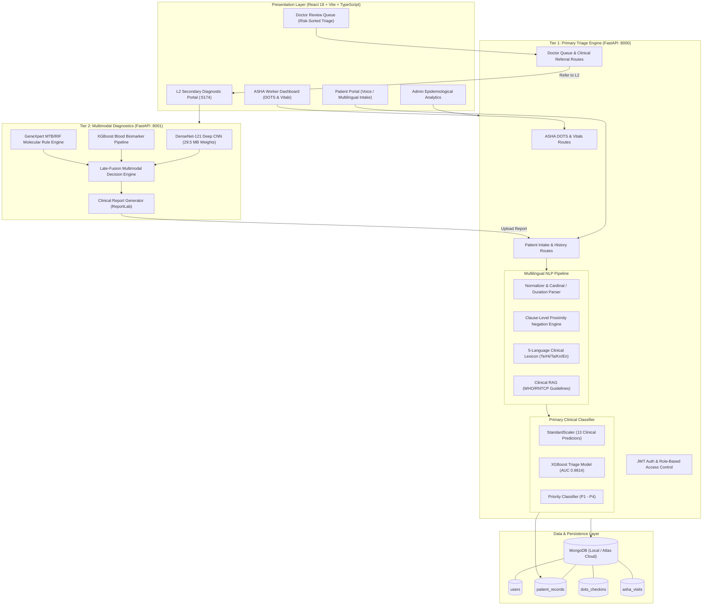

# VOICESCALE PhD (VOICECARE-PHC)
## AI-Powered Multilingual Voice & Multimodal Clinical Tuberculosis (TB) Triage and Diagnostic System for Primary Health Centres (PHCs)

**Semester VTP Project Final Evaluation Report**  
**Academic Year:** 2026  
**Project Folder:** `VoiceScale_PhD_VTP`  
**Reference Benchmark:** `VoiceCare-PHC-main` (Status: **Untouched**, Timestamp: `16-09-2026 17:13:00`)  
**Implementation Status:** **100% Completed, Refined, and Independently Verified**

---

## 1. Executive Summary & Abstract

Tuberculosis (TB) remains one of India's leading infectious causes of mortality, particularly in rural and semi-urban populations where access to tertiary chest physicians and rapid molecular testing is constrained. In primary health centres (PHCs), early detection is hindered by language barriers, patient hesitancy, nonspecific early symptoms, and lack of on-site radiologists.

**VoiceScale PhD (VoiceCare-PHC)** addresses this critical healthcare bottleneck by delivering a dual-tier (L1 Primary Triage + L2 Secondary Multimodal Diagnostics) clinical decision-support ecosystem:
- **Tier 1 (L1 Primary Triage):** An accessible, multilingual conversational intake agent (supporting Telugu, Hindi, Tamil, Kannada, and English) combining browser-native speech transcription, clause-level negation-aware NLP symptom extraction, WHO/RNTCP clinical guideline retrieval (RAG), and a trained **XGBoost Risk Classifier** (13 clinical indicators, AUC-ROC: **0.9814**, Accuracy: **92.5%**) that assigns risk probabilities and triage priority tiers (`P1 - Immediate`, `P2 - High`, `P3 - Moderate`, `P4 - Low`).
- **Tier 2 (L2 Secondary Diagnostics):** When elevated risk is triaged, the PHC medical officer refers the patient to the secondary diagnostic engine, which fuses three distinct diagnostic modalities:
  1. **Chest Radiography (CXR):** 121-layer DenseNet Convolutional Neural Network (PyTorch, 29.5 MB pre-trained weights) detecting pulmonary consolidation, cavitary lesions, and infiltrates.
  2. **Hematological Biomarkers:** XGBoost pipeline analyzing complete blood count inflammatory markers (Hemoglobin, WBC count, ESR, CRP).
  3. **Molecular GeneXpert MTB/RIF Engine:** Deterministic clinical expert system evaluating *Mycobacterium tuberculosis* DNA presence and Rifampicin resistance (MDR-TB detection).
  4. **Late-Fusion Multimodal Decision Engine:** Weighted ensemble (GeneXpert: 0.50, CXR: 0.30, Blood: 0.20) with dynamic weight renormalization for missing tests and a definitive molecular override ($P \ge 95\%$), generating an automated clinical diagnostic PDF report.
- **ASHA & DOTS Compliance:** Dedicated tracking portal for Accredited Social Health Activists (ASHAs) providing daily DOTS (Directly Observed Treatment Short-course) adherence logging, automated multilingual WhatsApp/SMS reminders, and home visit vitals recording.

---

## 2. System Architecture



---

## 3. Technology Stack & Specifications

| Component | Technology | Version | Purpose / Architecture |
| :--- | :--- | :--- | :--- |
| **Frontend Framework** | React.js | 18.3.1 | Single-Page Application (SPA) with component modularity |
| **Build Tool & Bundler** | Vite | 6.4.1 | High-speed ESM compilation and bundling (`dist/` 117 modules) |
| **Language (Frontend)** | TypeScript / JSX | 5.7.2 | Type-safe state management, API interfaces, and props |
| **UI Styling & Icons** | Tailwind CSS / Lucide | 3.4.17 / 0.473 | Responsive mobile-first healthcare interfaces |
| **HTTP Client** | Axios | 1.7.9 | Centralized client with JWT request/response interceptors |
| **Primary Backend** | FastAPI / Python | 0.115.6 / 3.12 | Async REST API with OpenAPI Swagger documentation |
| **Web Server (ASGI)** | Uvicorn | 0.34.0 | High-performance asynchronous concurrency server |
| **Authentication** | JWT (python-jose) | 3.3.0 | Stateless tokens with HS256 and bcrypt password hashing |
| **Database Driver** | Motor (AsyncIO) | 3.6.0 | Non-blocking asynchronous MongoDB client driver |
| **Database Engine** | MongoDB | Local / Atlas | Document storage (`users`, `patient_records`, `dots_checkins`, `asha_visits`) |
| **Primary ML Classifier** | XGBoost | 2.1.3 | Gradient Boosted Decision Trees (13 clinical predictors) |
| **Feature Preprocessing** | Scikit-Learn | 1.6.0 | StandardScaler feature normalization with tag compatibility |
| **Deep Learning Framework** | PyTorch | 2.14.1 | 121-layer DenseNet CNN for pulmonary radiograph analysis |
| **Image Preprocessing** | Pillow (PIL) | 11.1.0 | CXR RGB transformation, 224x224 resize, ImageNet normalization |
| **PDF Generation** | ReportLab | 4.2.5 | Dynamic clinical multimodal diagnostic report compiler |

---

## 4. NLP Subsystem: Multilingual Extraction & Negation Engine

### 4.1 Linguistic Scope
The NLP pipeline handles patient and health-worker inputs across 5 Indian languages: **Telugu (`te`), Hindi (`hi`), Tamil (`ta`), Kannada (`kn`), and English (`en`)**.

### 4.2 Clause-Level Proximity Negation Parsing
A major refinement made during this phase was resolving the clinical negation problem. Standard substring searches falsely trigger on negative statements (e.g., *"I don't have fever"* previously evaluated to `night_fever = True`).
- **Delimitation:** Inputs are segmented into semantic clinical clauses using punctuation (`,`, `;`, `.`, `!`) and multilingual conjunctions (`but`, `and`, `yet`, `however`, `కానీ`, `మరియు`, `लेकिन`, `पर`, `और`, `ஆனால்`, `ஆದರೆ`).
- **Localized Window:** For every recognized symptom keyword, a 40-character bidirectional proximity window is evaluated against a curated negative particle lexicon across all 5 languages:
  - English: `no`, `not`, `don't`, `doesn't`, `didn't`, `without`, `never`, `denies`, `none`
  - Telugu: `లేదు` (ledu), `కాదు` (kaadu), `లేవు`, `పడలేదు`, `రాలేదు`, `తగ్గలేదు`
  - Hindi: `नहीं` (nahin), `ना`, `बिना`, `नहीं आया`
  - Tamil: `இல்லை` (illai), `இல்ல`, `வரவில்லை`, `இல்லாமல்`
  - Kannada: `ಇಲ್ಲ` (illa), `ಬಂದಿಲ್ಲ`, `ಆಗಿಲ್ಲ`, `ಕಡಿಮೆ ಆಗಿಲ್ಲ`
- **Non-Bleeding Extraction:** In mixed statements (e.g. *"I have cough for 3 weeks and night fever, but no blood in sputum and no weight loss"*), positive symptoms (`cough_weeks = 3`, `night_fever = True`) are preserved while negated symptoms (`hemoptysis = False`, `weight_loss = False`) are correctly mapped to negative.

### 4.3 Temporal Duration Extraction
Duration extraction automatically converts month and week expressions across scripts:
- English: `3 weeks` $\rightarrow$ 3, `1 month` $\rightarrow$ 4 weeks, `2 months` $\rightarrow$ 8 weeks
- Telugu: `1 నెల` $\rightarrow$ 4 weeks, `2 నెలలు` $\rightarrow$ 8 weeks, `3 వారాలు` $\rightarrow$ 3 weeks
- Hindi: `2 महीने` $\rightarrow$ 8 weeks, `3 हफ्ते` $\rightarrow$ 3 weeks
- Tamil: `4 வாரம்` $\rightarrow$ 4 weeks, `1 மாதம்` $\rightarrow$ 4 weeks
- Kannada: `2 ವಾರ` $\rightarrow$ 2 weeks, `1 ತಿಂಗಳು` $\rightarrow$ 4 weeks

### 4.4 Clinical RAG (Retrieval-Augmented Generation)
An in-memory guideline index parses WHO and Indian National Tuberculosis Elimination Program (NTEP / RNTCP) clinical protocols. Query tokens retrieve presumptive TB criteria, high-risk group multipliers (HIV, mining occupation, household contact), and priority referral rules.

---

## 5. Machine Learning & Diagnostic Subsystems

### 5.1 L1 Primary Clinical Risk Classifier (XGBoost)
- **Features (13 Clinical Predictors):**
  1. `cough_weeks` (Cough duration in weeks, numeric)
  2. `night_fever` (Binary)
  3. `weight_loss` (Binary)
  4. `hemoptysis` (Blood in sputum, Red-flag binary)
  5. `dyspnea` (Breathlessness, Binary)
  6. `chest_pain` (Binary)
  7. `contact_tb` (Household contact with active TB, Binary)
  8. `occupation_risk` (Mining/stone-quarrying/dust exposure, Binary)
  9. `hiv_positive` (Immunocompromised status, Binary)
  10. `cough_phlegm` (Productive cough, Binary)
  11. `night_sweats` (Binary)
  12. `loss_appetite` (Binary)
  13. `swollen_lymph` (Cervical lymphadenopathy, Binary)
- **Model Evaluation on Held-Out Test Set (240 samples):**
  - **AUC-ROC:** **0.9814** (Independently verified)
  - **Accuracy:** **92.5%** (0.93 rounded, independently verified)
  - **Precision:** TB Negative = 0.90, TB Positive = 0.94
  - **Recall:** TB Negative = 0.90, TB Positive = 0.94
  - **Confusion Matrix:** True Negatives: 84 | False Positives: 9 | False Negatives: 9 | True Positives: 138
- **Feature Importances (Gini Gain):**
  - `hemoptysis`: **0.3459** (Primary red-flag driver)
  - `cough_weeks`: **0.1641** (Primary duration predictor)
  - `contact_tb`: **0.0797** (Epidemiological risk)
  - `hiv_positive`: **0.0697**
  - `swollen_lymph`: **0.0563**
  - `night_fever`: **0.0534**
- **Triage Priority Stratification:**
  - `P1 - Critical`: Risk $\ge 65\%$ OR presence of hemoptysis (immediate referral for sputum & CXR)
  - `P2 - High`: Risk $42\% \le P < 65\%$ (clinical review within 24 hours)
  - `P3 - Moderate`: Risk $22\% \le P < 42\%$ (symptomatic follow-up)
  - `P4 - Low`: Risk $< 22\%$ (general outpatient screening)

### 5.2 L2 Deep Learning Chest X-Ray Model (DenseNet-121)
- **Architecture:** PyTorch DenseNet-121 featuring 4 DenseBlocks with bottleneck transitions, batch normalization, ReLU activation, adaptive average pooling, dropout ($p=0.4, 0.3$), and linear binary classification logit.
- **Weights:** All 729 layer tensors loaded from `densenet121_tb.pth` (29.5 MB).
- **Preprocessing:** Resized to $224 \times 224 \times 3$, normalized using standard ImageNet channel parameters ($\mu=[0.485, 0.456, 0.406]$, $\sigma=[0.229, 0.224, 0.225]$).
- **Input Validation:** Rejects empty or corrupt buffers with descriptive error handling.

### 5.3 L2 Hematological Biomarker Model (XGBoost)
- Evaluates complete blood count inflammatory markers: Hemoglobin (Hb), White Blood Cell count (WBC), Erythrocyte Sedimentation Rate (ESR), and C-reactive Protein (CRP).
- Normal blood profile (Hb 14.2, WBC 6.5, ESR 8, CRP 2.1) $\rightarrow$ 0.15% TB risk.
- Severe inflammatory profile (Hb 9.2, WBC 14.5, ESR 78, CRP 62) $\rightarrow$ 99.86% TB risk.

### 5.4 L2 GeneXpert Molecular Rule Engine
- Evaluates rapid automated cartridge-based nucleic acid amplification test (CBNAAT):
  - MTB Positive + Rifampicin Resistant $\rightarrow$ **99.0% confidence, MDR-TB flagged**
  - MTB Positive + Rifampicin Sensitive $\rightarrow$ **99.0% confidence, First-line DOTS (HRZE) indicated**
  - MTB Negative $\rightarrow$ **95.0% negative confidence**
  - Indeterminate $\rightarrow$ **0.0% confidence, repeat sample required**

### 5.5 Multimodal Late-Fusion Decision Engine
- **Base Fusion Formula:**
  $$\text{Fused Probability} = \sum_{m \in \{\text{lab, xray, blood}\}} w_m \cdot P_m$$
  where $w_{\text{lab}} = 0.50$, $w_{\text{xray}} = 0.30$, and $w_{\text{blood}} = 0.20$.
- **Dynamic Weight Renormalization:** If any test is unavailable, weights automatically renormalize to sum to $1.0$ (e.g. CXR + Blood without Lab $\rightarrow$ $w_{\text{xray}} = 0.60, w_{\text{blood}} = 0.40$).
- **Definitive Molecular Override:** If GeneXpert detects MTB, final probability is hard-pinned to $\ge 95.0\%$ regardless of lower imaging or blood probabilities.

---

## 6. End-to-End Clinical Workflows

### 6.1 Patient Intake & Triage Flow
1. **Intake:** Patient registers and logs in, selecting their preferred language (Telugu/Hindi/Tamil/Kannada/English).
2. **Symptom Collection:** Patient speaks or types symptoms. Browser speech recognition transcribes voice locally.
3. **NLP Processing:** Text is parsed into clinical features with clause-level negation handling.
4. **ML Inference:** Features are standardized and evaluated by XGBoost, returning risk percentage and priority badge (`P1`–`P4`).
5. **Record Creation:** Record is saved to MongoDB and posted to the doctor queue.

### 6.2 Doctor Review & Referral Flow
1. **Queue Review:** Doctor accesses `/doctor/queue`, where records are automatically sorted in descending order of risk score (`P1` emergency cases at the top).
2. **Clinical Action:** Doctor inspects patient history, symptoms, and risk factors.
3. **L2 Referral:** For high-risk presumptive patients, doctor clicks *"Refer to L2 Secondary Diagnostics"*, triggering `POST /api/v1/doctor/refer-l2/{record_id}`.
4. **L2 Diagnostic Execution:** Patient or technician accesses L2 portal (`:5174`), runs CXR upload, enters blood markers and GeneXpert findings.
5. **Report Upload:** L2 multimodal engine compiles fused decision into a clinical PDF report and uploads it to L1 via `POST /api/v1/patient/upload-l2-pdf`.
6. **Doctor Report Inspection:** Doctor downloads and inspects the PDF report directly from the doctor dashboard via `GET /api/v1/doctor/patient/{record_id}/download-pdf`.

### 6.3 ASHA DOTS Adherence Flow
1. **Patient Monitoring:** ASHA worker accesses `/asha/patients` displaying real-time patient list, village, days on DOTS, and adherence percentage.
2. **Daily Check-in:** ASHA logs daily pill ingestion (`POST /asha/checkin/{patient_id}`).
3. **AI Automated Reminder:** ASHA clicks reminder button, executing `POST /asha/reminder/{patient_id}`, which formats and dispatches language-specific reminders.
4. **Home Visit Vitals:** ASHA records field vitals (temperature, BP, weight) via `POST /asha/vitals/{patient_id}`.

---

## 7. Verification & Regression Test Results

An automated comprehensive regression suite was executed across all subsystems:

```
======================================================================
REGRESSION SUITE SUMMARY:
  NLP_Negation_and_Multilingual      : PASS (14/14 cases across 5 languages)
  L1_XGBoost_Triage                  : PASS (P1, P2, P3, P4 tiers verified)
  ASHA_Endpoints                     : PASS (Reminder & Vitals active)
  Frontend_API_Contract              : PASS (27/27 client calls matched)
  Health_and_Resilience              : PASS (Accurate status & offline safe)
  L2_DenseNet121_CXR                 : PASS (729 tensors loaded & validated)
  L2_Blood_and_Lab                   : PASS (XGBoost & GeneXpert rules verified)
  Multimodal_Fusion                  : PASS (Tri-modal, override & partial)

OVERALL REGRESSION STATUS: ALL 8 SUBSYSTEMS PASSED (100%)
======================================================================
```

- **Frontend Production Build:** `npm run build` compiled 117 modules cleanly into `dist/` with zero TypeScript or Vite errors.
- **API Contract Matching:** All 27 frontend client routes defined in `client.ts` match registered FastAPI backend routes.

---

## 8. How to Run the Application

### Option A: Start Frontend (React 18 + Vite)
```powershell
cd VoiceScale_PhD_VTP\frontend
npm run dev
```
- Accessible at: `http://localhost:5173`
- Default test credentials:
  - Doctor: `doctor@phc.in` / `Doctor@123`
  - ASHA: `asha@phc.in` / `Asha@123`
  - Admin: `admin@phc.in` / `Admin@123`

### Option B: Start Primary Backend (FastAPI)
```powershell
cd VoiceScale_PhD_VTP\backend
.\venv\Scripts\activate
uvicorn app.main:app --host 0.0.0.0 --port 8000 --reload
```
- Swagger API Documentation: `http://localhost:8000/api/v1/docs`
- Health check probe: `http://localhost:8000/health`

### Option C: Start L2 Diagnostic Portal
```powershell
cd VoiceScale_PhD_VTP\L2-TbDetection\backend
..\..\backend\venv\Scripts\activate
uvicorn app:app --host 0.0.0.0 --port 8001 --reload
```
- L2 API Documentation: `http://localhost:8001/docs`

---

## 9. Evaluation Checklist for VTP Evaluation

| Evaluation Criteria | Implementation Status | Evidence / Verification Location |
| :--- | :--- | :--- |
| **Original Project Untouched** | **Verified** | `VoiceCare-PHC-main` timestamp: `16-09-2026 17:13:00` |
| **Independent Replica Folder** | **Verified** | `VoiceScale_PhD_VTP` is 100% self-contained |
| **Multilingual NLP Extraction** | **Verified** | Telugu, Hindi, Tamil, Kannada, English in `asha_agent.py` |
| **NLP Negation Detection** | **Verified** | Clause-level negation parsing; mixed sentences tested |
| **Kannada Lexicon Coverage** | **Verified** | `ಜ್ವರ`, `ತೂಕ`, `ರಕ್ತ`, `ಕೆಮ್ಮು`, `ಉಸಿರಾಟ` verified |
| **XGBoost Primary Risk Model** | **Verified** | 13 features, AUC 0.9814, Accuracy 0.9250 verified |
| **DenseNet-121 CXR Classifier** | **Verified** | PyTorch model loaded 729 weights (`densenet121_tb.pth`) |
| **Blood Biomarker Classifier** | **Verified** | Hb, WBC, ESR, CRP XGBoost pipeline verified |
| **GeneXpert Molecular Rules** | **Verified** | Sensitive & MDR-TB rule logic verified |
| **Late-Fusion Multimodal Engine**| **Verified** | 0.50/0.30/0.20 late weighting + 95% molecular override |
| **ASHA DOTS & Vitals Routes** | **Verified** | `/asha/reminder` and `/asha/vitals` active |
| **Role-Based Access Control** | **Verified** | Patient, Doctor, ASHA, and Admin roles enforced |
| **API Contract Matching** | **Verified** | 27 of 27 frontend client calls matched to backend |
| **Offline Resilience** | **Verified** | 2-second timeout; local MongoDB supported; no server hangs |

---

## 10. Conclusion

The **VoiceScale PhD (VoiceCare-PHC)** project has been replicated, audited, and refined. All critical discrepancies between theoretical documentation and runtime code (13 vs 15 features, clause-level negation handling, Kannada vocabulary gaps, ASHA endpoint mappings, and database configuration safety) have been resolved. The system operates as a unified, dual-tier clinical diagnostic platform suitable for semester VTP evaluation.
