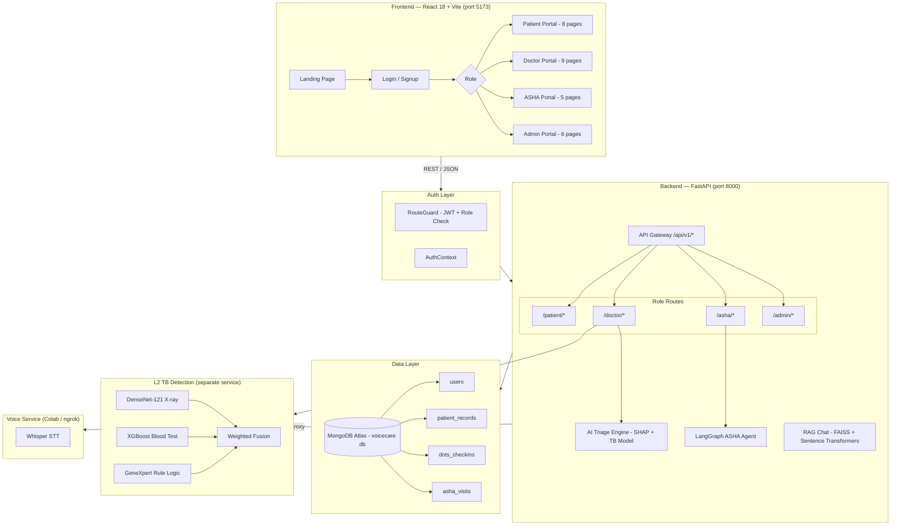

# VoiceCare PHC — Enterprise Edition v3.0

AI-powered TB triage for India's Primary Health Centres.  
**4 roles · 28 pages · Fully responsive (mobile + tablet + desktop)**

---

## Quick Start

### Backend
```bash
cd backend
python -m venv venv
# Windows:
venv\Scripts\activate
# Mac/Linux:
source venv/bin/activate
pip install -r requirements.txt
uvicorn app.main:app --host 0.0.0.0 --port 8000 --reload
```
API docs: http://localhost:8000/api/v1/docs

### Frontend
```bash
cd frontend
npm install
npm run dev
```
App: http://localhost:5173

### L2 TB Detection service (optional)

```bash
cd L2-TbDetection/backend
pip install -r requirements.txt
python app.py
```

```bash
cd L2-TbDetection/frontend
npm install
npm run dev
```

### Voice service (optional)

Open `backend/voice/VoiceCare_PHC.ipynb` in Google Colab, run all cells, and copy the ngrok URL into `VOICE_API_URL` in your `.env`.

---

## Environment Variables

```bash
cp backend/.env.example backend/.env
```

Edit `backend/.env`:

```env
MONGODB_URL=mongodb+srv://<user>:<password>@cluster.mongodb.net/
MONGODB_DB_NAME=voicecare
SECRET_KEY=your-secret-key
ANTHROPIC_API_KEY=sk-ant-...
VOICE_API_URL=https://<your-ngrok-url>.ngrok.io
CORS_ORIGINS=http://localhost:5173
```

---

## Architecture



---

## Roles

| Role | Route | Pages | Device |
|------|-------|-------|--------|
| Patient | `/patient/*` | 8 | Desktop + Mobile |
| PHC Doctor | `/doctor/*` | 9 | Desktop + Tablet |
| ASHA Worker | `/asha/*` | 5 | Mobile-first |
| Admin (NHM) | `/admin/*` | 6 | Desktop |

---

## Features

- **Voice-first symptom intake** — patients speak in their local language; Whisper STT transcribes and LangGraph structures the data
- **TB risk prediction** — XGBoost model with SHAP explainability scores each patient consultation
- **L2 TB Detection module** — DenseNet-121 chest X-ray analysis fused with XGBoost blood-test inference and rule-based GeneXpert lab logic
- **DOTS adherence tracking** — daily pill check-in logs and ASHA visit records
- **JWT authentication** — bcrypt password hashing and role-based route guards
- **ABDM FHIR R4 alignment** — data models designed for India's Ayushman Bharat Digital Mission
- **Multi-language support** — `LanguageContext` with `translations.ts` covering regional languages
- **RAG chat assistant** — FAISS vector store + Sentence Transformers for document-grounded Q&A

---

## Project Structure

```
VoiceCare-PHC/
├── frontend/                        # React 18 + Vite + TypeScript
│   └── src/
│       ├── api/client.ts            # Axios API client
│       ├── contexts/                # Auth, Language, Theme
│       ├── hooks/useVoiceProcess.ts # Voice capture hook
│       ├── components/              # RouteGuard, ModalProvider, etc.
│       └── pages/
│           ├── patient/             # 8 patient pages
│           ├── doctor/              # Doctor portal
│           ├── asha/                # ASHA worker portal
│           └── admin/               # Admin portal
│
├── backend/                         # FastAPI + Motor + MongoDB
│   ├── app/
│   │   ├── main.py                  # App entry, CORS, router registration
│   │   ├── api/                     # Route handlers per role
│   │   │   ├── auth.py
│   │   │   ├── patient.py
│   │   │   ├── doctor.py
│   │   │   ├── asha.py
│   │   │   ├── admin.py
│   │   │   ├── voice.py
│   │   │   └── chat.py
│   │   ├── agents/asha_agent.py     # LangGraph agent
│   │   ├── core/config.py           # Pydantic settings
│   │   └── db/
│   │       ├── database.py          # Motor connection + indexes
│   │       └── models.py            # Pydantic request/response models
│   ├── ml/
│   │   ├── tb_risk_model.json       # XGBoost model
│   │   ├── tb_scaler.pkl            # Feature scaler
│   │   └── train_tb_model.py        # Training script
│   ├── voice/
│   │   └── voicecare_colab_api.py   # Whisper STT Colab service
│   └── requirements.txt
│
└── L2-TbDetection/                  # Standalone TB detection service
    ├── backend/
    │   ├── app.py                   # FastAPI entry
    │   ├── chest_xray/              # DenseNet-121 model + inference
    │   ├── blood_test/              # XGBoost model + inference
    │   ├── lab_test/logic.py        # GeneXpert rule engine
    │   └── fusion/combine.py        # Weighted multi-modal fusion
    └── frontend/                    # React + Vite (JSX)
        └── src/pages/               # XrayPage, BloodTestPage, LabTestPage, FinalResultPage
```

---

## API Overview

All routes are prefixed with `/api/v1`.

| Group | Prefix | Description |
|-------|--------|-------------|
| Auth | `/auth` | Signup, login, password change, profile |
| Patient | `/patient` | Records, history, predictions, voice intake |
| Doctor | `/doctor` | Patient queue, consultation notes, SHAP results |
| ASHA Worker | `/asha` | Visit logs, DOTS check-ins, patient list |
| Admin | `/admin` | User management, analytics, NHM reporting |
| Voice | `/voice` | Whisper STT proxy to Colab service |
| Chat | `/chat` | RAG-powered clinical Q&A |

Full interactive docs: `http://localhost:8000/api/v1/docs`

---

## ML Models

### TB Risk Model (L1 — main backend)

- **Algorithm:** XGBoost with SHAP explainability
- **Input:** Structured symptom features from voice/form intake
- **Output:** Risk score (0–1) + top contributing features
- **Files:** `backend/ml/tb_risk_model.json`, `backend/ml/tb_scaler.pkl`

### L2 TB Detection (multi-modal fusion)

| Module | Model | Input |
|--------|-------|-------|
| Chest X-ray | DenseNet-121 (fine-tuned) | JPEG/PNG image |
| Blood test | XGBoost | CBC + ESR values |
| Lab test | Rule-based logic | GeneXpert result codes |
| Fusion | Weighted average | All three probabilities |

---

## Security

- **Authentication:** JWT tokens via `python-jose`
- **Passwords:** bcrypt hashing via `passlib`
- **Authorisation:** Role-based access control on both frontend (`RouteGuard`) and backend (dependency injection per router)
- **CORS:** Strict origin allowlist; configurable via `CORS_ORIGINS` env variable

---

## Tech Stack

| Layer | Technology |
|-------|-----------|
| Frontend | React 18, TypeScript, Vite, Bootstrap Icons |
| Backend | FastAPI 0.115, Python 3.10+, Uvicorn |
| Database | MongoDB Atlas, Motor (async driver) |
| Auth | JWT (python-jose), bcrypt (passlib) |
| ML — Risk | XGBoost 2.1, scikit-learn 1.6, SHAP |
| ML — Imaging | PyTorch, DenseNet-121 |
| AI Agents | LangGraph, LangChain, Anthropic Claude |
| Voice STT | OpenAI Whisper |
| RAG | FAISS, Sentence Transformers |
| Scheduling | APScheduler |

---

## Deployment Notes

- Set `CORS_ORIGINS` to your production frontend URL in the server environment.
- The voice service requires a running Colab session with a public ngrok URL; for production, consider hosting Whisper on a dedicated GPU instance.
- MongoDB Atlas free tier (M0) is sufficient for development; upgrade to M10+ for production workloads.
- The L2 detection service can be deployed independently behind a reverse proxy.

---

## License

MIT License — see [LICENSE](LICENSE) for details.

---

© 2026 VoiceCare PHC · Whisper STT · LangGraph · XGBoost · DenseNet-121 · FHIR R4 · IIIT Sri City
